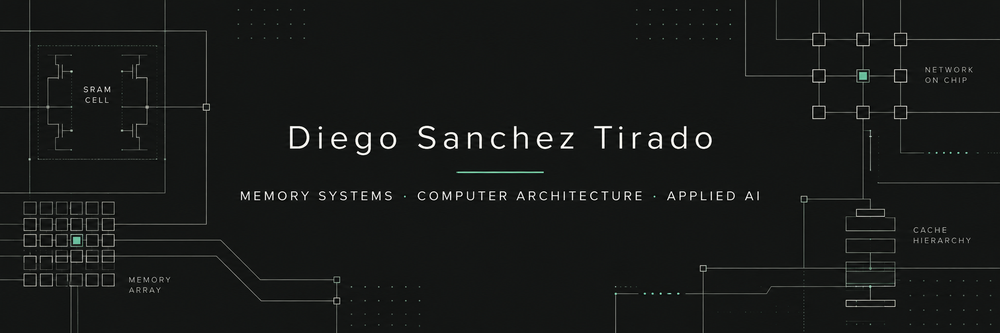

  

  <a href="https://diegosancheztirado.com">Website</a> ·
  <a href="https://www.linkedin.com/in/diego-sanchez-tirado">LinkedIn</a> ·
  <a href="https://diegosancheztirado.com/Diego-Sanchez-Tirado-Resume.pdf">Resume</a> ·
  <a href="mailto:dsanchezt22@gmail.com">Email</a>

## About me

I'm an electrical engineering student at Stanford working where computer architecture, memory systems, physical hardware, and applied AI meet.

- Researching area-scalable memory architectures for LLM inference with Stanford's Engineering Robust Systems Group.
- Building evidence-grounded AI systems at [Verdnt Group](https://github.com/verdnt-group).
- Previously built knowledge infrastructure and trained humanoid-robot policies at Amazon Lab126.
- Interested in Summer 2027 opportunities across architecture, memory systems, hardware, and AI/software engineering.

## Languages and tools

  
  
  
  
  
  

| Area | Experience |
| --- | --- |
| **Architecture and modeling** | HBM, NoC, tensor and pipeline parallelism, capacity and bandwidth analysis, long-context KV-cache regimes |
| **Applied AI and systems** | LLM evaluation, RAG, structured model output, prompt-injection and PII gates, ACT, diffusion policies, TD3 |
| **Application development** | FastAPI, Next.js, React, Node.js, data ingestion, retrieval pipelines, human-in-the-loop workflows |
| **Hardware and fabrication** | Circuit and PCB design, soldering, embedded systems, microphone arrays, LiDAR, piezoelectric instrumentation |
| **CAD and prototyping** | Onshape, SolidWorks/FEA, CNC, 3D printing, laser cutting |
| **Workflow** | Git, Cloudflare Workers, n8n, Apollo, HubSpot |

## Experience

### Stanford Engineering Robust Systems Group

Modeling LLM-inference throughput, latency, memory capacity, bandwidth density, and mesh/NoC behavior across area-scalable and HBM-backed architectures. The work explores how topology and parallelism choices affect long-context, KV-cache-heavy inference.

### Amazon Lab126

- Built a daily, idempotent pipeline that transformed Outlook, Slack, and Confluence data into a searchable Markdown knowledge corpus.
- Developed an LLM-as-judge classifier with an auto-discovered taxonomy, typed links, conflict review, and prompt-injection and PII admission gates.
- Trained and evaluated ACT and diffusion imitation policies for physical bimanual tasks, then extended behavior with residual reinforcement learning.

### Verdnt Group

Building custom research and decision systems that combine multi-source collection, evidence-backed analysis, transparent scoring, and human review.

## Selected work

### Area-scalable memory systems

Python models comparing LLM-inference throughput, latency, capacity, and interconnect behavior across distributed memory and HBM organizations, including TP/PP planning and compute, memory, and network breakdowns.

### FSTea market-intelligence cockpit

A bilingual product-development system combining public market signals, competitor analysis, evidence-backed concept generation, transparent scoring, and human review.

### [Trus](https://github.com/dsanchezt22/Generative-Workspace)

A shipped generative workspace that translated natural-language requests into safe, editable tools using structured model output and a trusted component library. The product is now retired.

### Hardware systems

Independent work spanning a custom split ergonomic keyboard and PCB, typing-force piezoelectric energy harvesting, and free-air active noise control using microphone arrays and LiDAR.

### Cyber threat intelligence

Co-authored the *LATAM Financial Threat Landscape 2025* with Duke Pratt, DigiAmericas, and Recorded Future, covering major regional threat actors and maintaining a Git-tracked IOC/TTP pipeline mapped to MITRE ATT&CK.

## A little more

- Fluent in English and Spanish.
- Onshape certified, with additional SolidWorks/FEA and digital-fabrication experience.
- Former FTC RoboKnights 8569 competitor, finishing 5th of 390 teams at the North Carolina State Championship.
